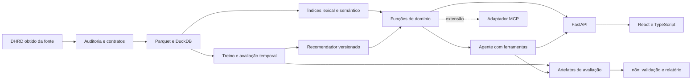

# Arquitetura proposta

Somente o auditor CSV existe nesta versão. Os outros componentes abaixo são planejados.

Python para dados e modelos; DuckDB/Parquet para processamento local; FastAPI para contratos; React/TypeScript e tokens CSS para interface. Versões de dependências e arquivo de lock serão fixados ao implementar cada componente e verificar compatibilidade. Não incluir dependências vazias apenas para aparência de completude.

Contratos candidatos: `search_catalog(query, filters, limit)`, `recommend(profile_id, filters, limit)`, `get_item(item_id)`, `get_evaluation(run_id)`. Saídas terão IDs, metadados, origem, versão e avisos de cobertura. Nunca aceitar SQL, código arbitrário ou URLs fornecidas pelo LLM para execução.

Separar os modelos de recuperação/ranking do modelo de linguagem. A interface consulta o mesmo serviço usado pelo agente, permitindo comparar filtros convencionais com conversa. Pontuação de ranking não será apresentada como probabilidade de satisfação.

Registrar run_id, versões, ferramenta, duração, tokens/custo quando disponíveis e erros. Remover credenciais e limitar persistência do conteúdo de conversa. Incluir modo sem LLM para falhas ou orçamento esgotado. Resultados sintéticos de desenvolvimento serão identificados e separados dos resultados com DHRD.
