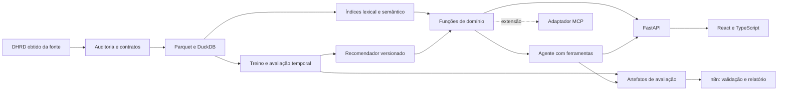

# Arquitetura proposta

Implementados: auditor CSV, preparação específica da cópia real de Singapura em SQLite, contratos de contexto/quarentena e validação temporal de três recomendadores. A primeira execução real usou todos os 109.842 usuários de validação. Fixtures sintéticas existem somente em testes. API, índices de busca, agente, frontend e n8n permanecem planejados.

Atualização de origem: a distribuição oficial completa foi recebida, verificada e auditada em 7/11/2026. `official-source-selection-v1.json` registra os papéis dos quinze arquivos. O extrator e o auditor oficiais estão implementados; o adaptador de treino atual continua fixado no espelho para reproduzir o Experimento 001. A próxima versão deverá ler os originais diretamente, com teste oficial fisicamente separado. [Plano da migração](OFFICIAL_DATA_MIGRATION.md).

Fluxo executável atual: CSVs reais fixados por SHA-256 → normalização e quarentena por pedido → SQLite somente leitura para análise → perfis de treino congelados → popularidade/repetição/cosseno por cesta → relatório de validação. Contextos preservam geohash, rede e dia da semana para próximas etapas; ainda não são filtros de candidatos. SQLite foi escolhido para integridade e transações sem dependência de execução adicional; a arquitetura abaixo permanece a visão de evolução.

Python para dados e modelos; DuckDB/Parquet são opções futuras de processamento; FastAPI para contratos; React/TypeScript e tokens CSS para interface. Versões de dependências e arquivo de lock serão fixados ao implementar cada componente e verificar compatibilidade. Não incluir dependências vazias apenas para aparência de completude.

Contratos candidatos: `search_catalog(query, filters, limit)`, `recommend(profile_id, filters, limit)`, `get_item(item_id)`, `get_evaluation(run_id)`. Saídas terão IDs, metadados, origem, versão e avisos de cobertura. Nunca aceitar SQL, código arbitrário ou URLs fornecidas pelo LLM para execução.

Separar os modelos de recuperação/ranking do modelo de linguagem. A interface consulta o mesmo serviço usado pelo agente, permitindo comparar filtros convencionais com conversa. Pontuação de ranking não será apresentada como probabilidade de satisfação.

Registrar run_id, versões, ferramenta, duração, tokens/custo quando disponíveis e erros. Remover credenciais e limitar persistência do conteúdo de conversa. Incluir modo sem LLM para falhas ou orçamento esgotado. Resultados sintéticos de desenvolvimento serão identificados e separados dos resultados com DHRD.
